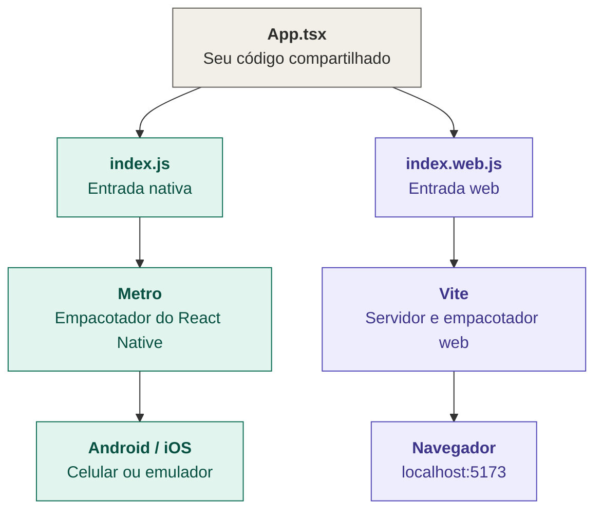

# Diferenças entre React Native CLI e Expo

## Diferença principal

A **React Native CLI** cria um projeto React Native sem um framework adicional: você controla diretamente os projetos nativos de Android e iOS. O **Expo** é um framework construído sobre React Native, com ferramentas, APIs e configurações prontas para acelerar o desenvolvimento. 
A documentação oficial do React Native recomenda recomenda a utilização do framework Expo para novos projetos, mas também reconhece que a CLI sem framework faz sentido quando você precisa de controle direto ou tem requisitos específicos.


## Desvantagens do Expo e React Native CLI

| Expo | React Native CLI |
| ----------- | ----------- |
| **O Expo Go tem limites:** ele só executa bibliotecas nativas que já estão incluídas nele. Para adicionar outras bibliotecas com código nativo, normalmente você cria um *development build* — uma versão de desenvolvimento do seu próprio app.| **Mais configuração inicial:** você precisa preparar ferramentas nativas como Android Studio e, para iOS, Xcode e CocoaPods.|
|**Pode exigir novas compilações:** depois de instalar bibliotecas nativas ou alterar configurações nativas, você precisa gerar uma nova versão de desenvolvimento. Isso é diferente de apenas atualizar JavaScript.| **Mais decisões para tomar:** navegação, bibliotecas nativas, atualizações e configurações podem exigir escolhas e ajustes manuais.|
|**O fluxo de projeto pode ser menos direto para quem quer editar tudo manualmente:** projetos Expo podem gerar os diretórios nativos a partir da configuração. Se você alterar arquivos gerados diretamente, essas alterações podem ser perdidas em uma nova geração; o caminho recomendado é usar plugins de configuração ou gerenciar os diretórios nativos com cuidado. | **A web não vem pronta:** é necessário configurar ferramentas como Vite e `react-native-web`; algumas bibliotecas também podem precisar de ajustes extras.|
| **Algumas ferramentas são específicas do ecossistema Expo:** isso pode adicionar etapas se sua equipe já tiver um fluxo nativo próprio. Ainda assim, Expo e seus serviços podem ser usados em projetos React Native existentes, então não significa que seja obrigatório recomeçar o app do zero. | **Mais manutenção do ambiente nativo:** você tem acesso direto aos projetos Android e iOS, mas também fica responsável por gerenciar as mudanças neles.|


Se você não precisa mexer diretamente nas pastas `android/` e `ios/`, o **Expo** já traz suporte à web pronto (`npx expo start --web`) e é o caminho recomendado pela documentação do React Native para novos projetos. Porém se você quiser mais controle da estrutura interna do seu applicativo, então é melhor usar o **React Native CLI**, aonde você é limitado de acesso pelo **Expo**.

# Tutorial: criando um projeto React Native CLI rodando na web

Neste tutorial você vai criar um app com a **CLI do React Native** e depois configurar para que o **mesmo código** rode no celular (Android/iOS) e no **navegador**.

Ao final você terá:

- um app React Native funcionando no Android/iOS;
- o mesmo app abrindo em `http://localhost:5173` no navegador;
- uma primeira tela com componente próprio e tratamento correto de área segura (notch e barra de status).


---

## Índice

1. [Entendendo as peças](#1-entendendo-as-peças)
2. [Pré-requisitos](#2-pré-requisitos)
3. [Criar o projeto](#3-criar-o-projeto)
4. [Instalar as dependências da web](#4-instalar-as-dependências-da-web)
5. [Criar os arquivos da web](#5-criar-os-arquivos-da-web)
6. [Adicionar os scripts no package.json](#6-adicionar-os-scripts-no-packagejson)
7. [Criar a primeira tela](#7-criar-a-primeira-tela)
8. [Rodar o projeto](#8-rodar-o-projeto)
9. [Problemas comuns](#9-problemas-comuns)
10. [Glossário](#10-glossário)

---

## 1. Entendendo as peças

Antes de digitar comandos, vale entender o que cada ferramenta faz. Isso ajuda muito quando aparece um erro.

| Peça | O que é | Para que serve aqui |
|---|---|---|
| **React Native CLI** | Ferramenta oficial de linha de comando | Cria o projeto com as pastas `android/` e `ios/` |
| **Metro** | Empacotador do React Native | Entrega o código JavaScript para o app no celular |
| **react-native-web** | Biblioteca | Traduz componentes como `View` e `Text` para HTML (`div`, `span`) |
| **react-dom** | Biblioteca do React para navegadores | Desenha os componentes na página web |
| **Vite** | Servidor de desenvolvimento e empacotador | Faz o mesmo papel do Metro, só que para a **web** |

Em resumo, o projeto tem **dois caminhos** de execução que compartilham o mesmo código:



---

## 2. Pré-requisitos

Você precisa ter instalado:

- **Node.js 20 ou superior**
- **JDK 17** e **Android Studio** (para rodar no Android)
- **Xcode** e **CocoaPods** (para iOS, somente em macOS)

Guia oficial de configuração do ambiente: https://reactnative.dev/docs/set-up-your-environment

Verifique:

```bash
node -v
npx react-native doctor
```


---

## 3. Criar o projeto

```bash
npx @react-native-community/cli@latest init MeuApp
cd MeuApp
```

- Cria o projeto em React Native com o template oficial e cria a pasta `MeuApp` com tudo pronto: `android/`, `ios/`, `App.tsx`, `package.json` etc. O `cd MeuApp` entra nela.

> **Regra de ouro daqui em diante:** todos os comandos e arquivos deste tutorial são feitos **dentro da pasta do projeto**, a mesma que contém o `package.json`.

**✅ Checkpoint:**

```bash
pwd
ls package.json
```

O `pwd` termina em `MeuApp` e o `ls` mostra `package.json`.

---

## 4. Instalar as dependências da web

### 4.1 Descubra a versão do React

```bash
npm ls react
```

Procure a linha `react@19.x.x` (a sua pode ser diferente). Anote o número.

### 4.2 Instale as bibliotecas

Troque `19.3.0` pela versão que você anotou:

```bash
npm install react-dom@19.3.0 react-native-web
npm install -D vite @vitejs/plugin-react
```

**Por que fixar a versão do `react-dom`?** O `react-dom` precisa ter **exatamente a mesma versão** do `react`. Se você rodar apenas `npm install react-dom`, o npm tenta instalar a mais recente, que pode ser diferente da sua, e aparece o erro `ERESOLVE`.

**O que cada comando instala:**

- `react-dom` e `react-native-web`: dependências do app (rodam no navegador).
- `vite` e `@vitejs/plugin-react`: ferramentas de desenvolvimento (a flag `-D` as coloca em `devDependencies`).


**✅ Checkpoint:**

```bash
npm ls react react-dom
npx vite --version
```

O `react` e o `react-dom` aparecem com a **mesma versão**, e o segundo comando mostra um número de versão do Vite.

> **Importante:** as dependências valem **por projeto**. Todo projeto novo precisa repetir este passo. Se você pular, aparece o erro `vite: not found`.

---

## 5. Criar os arquivos da web

Você vai criar **3 arquivos na raiz** do projeto (ao lado do `package.json`). O template do React Native não os cria, porque ele é feito só para celular.

> **Dica:** crie um arqutor de texto (poivo por vez, usando um edir exemplo `mousepad nome-do-arquivo &` no Xubuntu, ou o VS Code).

### 5.1 `index.html`

É a página que o navegador abre. Ela tem uma `<div id="root">` onde o app será desenhado.

```html
<!DOCTYPE html>
<html lang="pt-BR">
  <head>
    <meta charset="UTF-8" />
    <meta name="viewport" content="width=device-width, initial-scale=1" />
    <title>MeuApp</title>
    <style>
      html, body, #root { height: 100%; margin: 0; }
      body { font-family: system-ui, sans-serif; }
    </style>
  </head>
  <body>
    <div id="root"></div>
    <script type="module" src="/index.web.js"></script>
  </body>
</html>
```

**Por que aquele `<style>`?** No React Native, `flex: 1` significa "ocupe todo o espaço disponível". Na web isso só funciona se os elementos acima (`html`, `body` e `#root`) também tiverem altura. 

### 5.2 `index.web.js`

É a **porta de entrada da web**, equivalente ao `index.js` do celular.

```js
import { AppRegistry } from 'react-native';
import App from './App';

AppRegistry.registerComponent('MeuApp', () => App);
AppRegistry.runApplication('MeuApp', {
  rootTag: document.getElementById('root'),
});
```

**O que isso faz:** registra o seu `App` e manda desenhá-lo dentro da `<div id="root">`. O nome vem do `app.json`, então este arquivo funciona em qualquer projeto sem edição.

### 5.3 `vite.config.mjs`

Configura o Vite para entender React Native.

```js
import { defineConfig } from 'vite';
import react from '@vitejs/plugin-react';

export default defineConfig({
  plugins: [react()],
  resolve: {
    extensions: ['.web.tsx', '.web.ts', '.web.js', '.tsx', '.ts', '.js', '.jsx'],
    alias: {
      'react-native': 'react-native-web',
    },
  },
  define: {
    __DEV__: JSON.stringify(true),
    global: 'window',
  },
});
```

**O que cada bloco faz:**

- `plugins: [react()]`: ensina o Vite a processar JSX/TSX.
- `alias`: sempre que o código fizer `import ... from 'react-native'`, o Vite entrega o `react-native-web`. É o que permite usar `View` e `Text` no navegador.
- `extensions`: faz o Vite preferir arquivos terminados em `.web.tsx` quando existirem (útil para código específico da web).
- `define`: cria as variáveis globais `__DEV__` e `global`, que algumas bibliotecas do React Native esperam encontrar.

**Por que `.mjs` e não `.js`?** O projeto é CommonJS por padrão, e o arquivo usa `import/export` (ESM). Com `.mjs`, o Node entende que é ESM e o Vite não mostra aquele aviso laranja.

**✅ Checkpoint:**
Os quatro arquivos devem aparecer ao executar o comando abaixo: 

```bash
ls index.html index.web.js vite.config.mjs app.json
```

A raiz do projeto deve estar assim:

```
MeuApp/
├── android/
├── ios/
├── App.tsx
├── app.json
├── index.js          (entrada nativa, já existia)
├── index.web.js      (entrada web, você criou)
├── index.html        (você criou)
├── vite.config.mjs   (você criou)
└── package.json
```

---

## 6. Adicionar os scripts no `package.json`

Abra o `package.json` e acrescente três linhas dentro de `"scripts"`. Cuidado com as **vírgulas**: uma vírgula esquecida quebra o arquivo.

```json
"scripts": {
  "android": "react-native run-android",
  "ios": "react-native run-ios",
  "lint": "eslint .",
  "start": "react-native start",
  "test": "jest",
  "web": "vite",
  "build:web": "vite build",
  "preview:web": "vite preview"
}
```

**O que são:** atalhos de comando. A partir de agora, `npm run web` executa `vite`.

**✅ Checkpoint:**

```bash
npm run web
```


